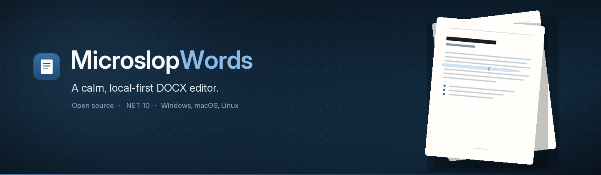
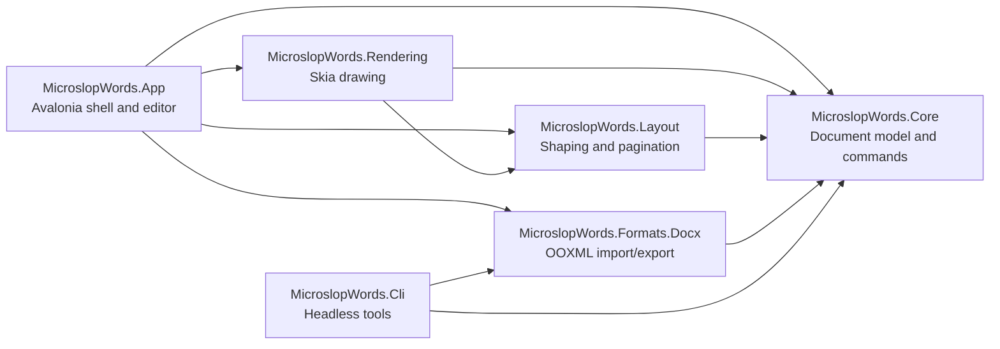

<div align="center">
  
</div>

<p align="center">
  <strong>A calm, local-first DOCX editor for Windows, macOS, and Linux.</strong><br>
  Open, edit, and save Word documents with deterministic layout, clean round-tripping,
  and a codebase you can actually read.
</p>

<p align="center">
  <a href="https://github.com/Zenzenmann/MicroslopWords/actions/workflows/ci.yml">
    
  </a>
  <a href="LICENSE">
    
  </a>
  <a href="https://dotnet.microsoft.com/download/dotnet/10.0">
    
  </a>
  <a href="#quick-start">
    
  </a>
</p>

<p align="center">
  <a href="#why-microslopwords">Why</a> ·
  <a href="#status">Status</a> ·
  <a href="#quick-start">Quick start</a> ·
  <a href="#architecture">Architecture</a> ·
  <a href="#contributing">Contributing</a> ·
  <a href="#license">License</a>
</p>

---

MicroslopWords is an open-source word processor built with C#, Avalonia, and a native Skia rendering pipeline. It is a practical DOCX editor, not a clone of every Microsoft Word feature: the goal is predictable editing, faithful round-tripping of the documents people actually exchange, and a small, inspectable codebase.

It is deliberately not a Word clone. Macros, real-time coauthoring, cloud sync, an add-in marketplace, and 100% Word fidelity are out of scope.

## Why MicroslopWords

- **Local-first, always.** No account, no cloud, no telemetry. Documents never leave your machine, and the editor makes no network calls while opening, editing, saving, or printing.
- **Deterministic by construction.** Layout is a pure function of the document, styles, page settings, and fonts, so identical inputs always produce identical pages. Screen, print, and PDF are designed around that one layout engine.
- **DOCX that stays DOCX.** Edits are saved as document structure — paragraphs, runs, styles, and lists — not flattened text. Unsupported content is preserved where it is safe and disclosed before it can be lost.
- **A codebase you can read.** Six focused projects with one-way dependencies, architecture decision records, an executable spec, and tests for every new behavior.

## Status

MicroslopWords is in **early, active development**. Core editing works today; the remaining v1 capabilities are being implemented story by story against a published spec.

**Available now**

- Open, create, and save `.docx` files with Save As, atomic writes, and unsaved-change tracking
- Paginated editing with caret, selection, IME input, paragraph split/merge, and soft breaks
- Zoom from 25% to 400%, with fit-width and fit-page
- Character formatting: font family, size, bold, italic, underline, strikethrough, text color, and highlight
- Paragraph formatting: alignment, spacing, indents, bulleted and numbered lists (nine levels), and page breaks
- Cut, copy, and paste with plain-text and HTML interop; command-based undo/redo
- Crash recovery snapshots with a restore prompt on the next launch
- Documents with unsafe or unsupported content open read-only instead of risking data loss

**In progress**

- Named styles: applying, inspecting, and editing style definitions

**Planned for v1**

- Find and replace
- Tables and inline images
- Headers, footers, and page numbers
- Print and PDF export
- Accessibility, keyboard map, themes, and settings
- Headless CLI for inspection, validation, text extraction, and PDF export
- Self-contained releases for Windows, macOS, and Linux

The canonical capability list and acceptance criteria live in [`SPEC.md`](_bmad-output/planning-artifacts/specs/spec-microslopwords/SPEC.md) and [`stories.yaml`](_bmad-output/planning-artifacts/specs/spec-microslopwords/stories.yaml).

## Quick start

**Prerequisites:** [.NET 10 SDK](https://dotnet.microsoft.com/download/dotnet/10.0) and a desktop session on Windows, macOS, or Linux.

```bash
git clone https://github.com/Zenzenmann/MicroslopWords.git
cd MicroslopWords
dotnet restore
dotnet run --project src/MicroslopWords.App
```

Run the same gates CI enforces before opening a pull request:

```bash
dotnet build
dotnet test
dotnet format --verify-no-changes
```

CI builds and tests on Windows, Linux, and macOS.

## Architecture



Arrows point from a project to the projects it references. The direction is enforced: Core knows nothing about UI, OOXML, Skia, or the file system; Layout is a pure, headless function of document state; Rendering never reflows text. Every edit is an invertible command, and layout never mutates the document.

| Project | Responsibility |
| --- | --- |
| `MicroslopWords.Core` | Immutable document model, commands, undo/redo, styles, selections |
| `MicroslopWords.Layout` | HarfBuzz shaping, line breaking, pagination, layout boxes |
| `MicroslopWords.Rendering` | Skia drawing of pages, caret, and selection |
| `MicroslopWords.Formats.Docx` | OOXML import and export |
| `MicroslopWords.App` | Avalonia desktop shell, MVVM, editor control, dialogs |
| `MicroslopWords.Cli` | Headless conversion, corpus checks, diagnostics |

<details>
<summary>Repository layout</summary>

```text
src/
  MicroslopWords.Core/          Document model, commands, undo/redo, styles
  MicroslopWords.Layout/        Text shaping, line breaking, pagination
  MicroslopWords.Rendering/     Skia drawing, caret, selection
  MicroslopWords.Formats.Docx/  OOXML import/export
  MicroslopWords.App/           Avalonia desktop application
  MicroslopWords.Cli/           Headless conversion and diagnostics
tests/
  MicroslopWords.Core.Tests/
  MicroslopWords.Layout.Tests/
  MicroslopWords.Docx.Tests/
  MicroslopWords.Ui.Tests/
docs/
  adr/                          Architecture decision records
  bmad/                         BMAD operating guide
_bmad-output/                   BMAD planning and implementation artifacts
scripts/                        Automation and developer tooling
```

</details>

## Contributing

Contributions of every size are welcome — bug reports, DOCX fixtures, documentation, and code.

- Read [`CONTRIBUTING.md`](CONTRIBUTING.md) for setup, commit style, and review requirements.
- Pick an approved story from [`stories.yaml`](_bmad-output/planning-artifacts/specs/spec-microslopwords/stories.yaml) or open an issue.
- Keep one coherent change per branch and make sure the build, test, and format gates pass.

This project uses the [BMAD method](docs/bmad/README.md). Product requirements, architecture, capability IDs, and stories live under `_bmad-output/planning-artifacts/`; the canonical contract is `SPEC.md`. Stories are implemented one at a time through the automated harness:

```powershell
./scripts/auto-build.ps1 -Story STORY-001
```

See [`AGENTS.md`](AGENTS.md) for the agent contract and [`docs/adr/`](docs/adr/) for architecture decisions.

## Security

DOCX files are treated as untrusted input: macros, ActiveX, OLE, scripts, and embedded executables are never executed, and no network fetch happens during open, edit, save, or print. Please report vulnerabilities privately through the repository's **Security** tab; do not open a public issue. See [`SECURITY.md`](SECURITY.md) for scope and disclosure policy.

## License

MIT. See [`LICENSE`](LICENSE).

<p align="center">
  <sub>Built with .NET 10, Avalonia, SkiaSharp, HarfBuzzSharp, and the Open XML SDK.</sub>
</p>
