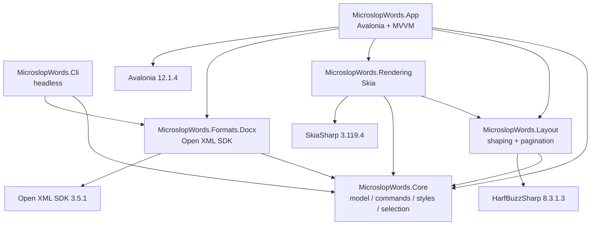
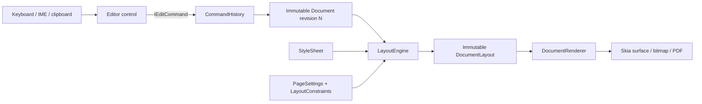

# MicroslopWords Architecture Spine

## Design Paradigm

**Layered hexagonal (ports-and-adapters) architecture with command-sourced immutable state and a pure layout compiler.**

- Domain core: `MicroslopWords.Core` owns the document model, commands, history, styles, and selection.
- Pure transformation: `MicroslopWords.Layout` turns document inputs into immutable layout boxes.
- Output adapter: `MicroslopWords.Rendering` draws layout boxes through Skia.
- Format adapter: `MicroslopWords.Formats.Docx` is the only production home of OOXML mapping.
- Driving adapters: `MicroslopWords.App` (Avalonia desktop) and `MicroslopWords.Cli` (headless).
- Composition roots: `App` for desktop, `Cli` for scripts and diagnostics. No other project composes the full system.

### System boundaries

| Boundary | Owns | Must not |
|---|---|---|
| `Core` | Document tree, stable IDs, styles, selections, commands, undo/redo | Avalonia, Open XML, Skia, file-system UI, process/network I/O |
| `Layout` | Text shaping, line breaking, pagination, immutable layout boxes | Avalonia, Open XML, rendering, file/system I/O, mutable global state |
| `Rendering` | Skia drawing of layout boxes, caret/selection overlays, bitmap/PDF output | Document mutation, line breaking, Open XML, UI event handling |
| `Formats.Docx` | OOXML import/export, package parts, unsupported-content diagnostics | Avalonia, Skia, layout, document mutation outside a returned model value |
| `App` | Avalonia shell, MVVM, editor control, input/IME, dialogs, file pickers | Format mapping, layout algorithms, undo/redo outside `CommandHistory` |
| `Cli` | Headless commands, deterministic text output, exit codes | Avalonia, `App`, rendering, interactive prompts, network access |



The runtime edit path is one-way from input to commands to a new immutable document, then through layout and rendering:



## Invariants & Rules

`[ADOPTED]` means the decision is already fixed by the user, `AGENTS.md`, or an accepted ADR. `[ASSUMPTION]` means this spine inferred a shape that no existing source settled. The ADs below are binding; the seed in this document is evidence, not a capability claim.

### AD-1 — Production dependencies follow a one-way graph [ADOPTED]

- **Binds:** all production projects, project references, and third-party package families.
- **Prevents:** Core/UI/format coupling, dependency cycles, and accidental platform or file-system dependencies.
- **Rule:** Allowed production project references: `Core` to none; `Layout` to `Core` and HarfBuzzSharp; `Rendering` to `Core`, `Layout`, and SkiaSharp; `Formats.Docx` to `Core` and the Open XML SDK; `App` to `Core`, `Layout`, `Rendering`, `Formats.Docx`, Avalonia, and CommunityToolkit.Mvvm; `Cli` to `Core` and `Formats.Docx`. Test-only packages and test project references do not create production edges. Any new production edge requires an ADR.

### AD-2 — The document model is immutable and IDs are stable for the document lifetime [ADOPTED]

- **Binds:** `Core.Documents`, `Layout`, `Rendering`, `Formats.Docx`, `App`, collaboration-ready command history.
- **Prevents:** in-place mutation, ID reuse or renumbering, OOXML identity leaking into the model, and assumptions that IDs survive a save/open cycle.
- **Rule:** `Document`, `Section`, `Block`, `Run`, and style values are immutable records backed by `ImmutableArray`; edits produce new values. Every section, block, and run gets a `Guid` at creation; existing IDs are never changed, reused, or renumbered. IDs are stable for one document lifetime only: DOCX import mints new IDs, and IDs are never written into OOXML or used as OOXML identifiers. Replacing a block preserves that block's ID.

### AD-3 — Every document mutation is a command owned by CommandHistory [ADOPTED]

- **Binds:** `Core.Editing`, `App`, `Cli`, and any future collaboration layer.
- **Prevents:** direct mutation from UI or adapters, hidden undo stacks, and edits that cannot be inverted.
- **Rule:** All document edits implement `IEditCommand` with deterministic `Apply` and `Revert`. `CommandHistory` is the sole owner of the current document and the undo/redo stacks; UI and CLI dispatch commands rather than replacing documents. `Apply` preserves unrelated IDs and ordering; `Revert` restores the exact pre-`Apply` model state. A new command clears redo. Snapshot storage is an implementation detail, not permission to bypass `Revert` semantics.

### AD-4 — Selection and caret are logical Core identities, not pixels or document indices [ASSUMPTION]

- **Binds:** `Core` selection types, the editor control, layout overlays, find/replace.
- **Prevents:** UI-owned offsets, selections invalidated by unrelated edits, and pixel-based caret placement that diverges from the model.
- **Rule:** `Core` exposes immutable `Selection` and `SelectionMap` value types. A selection is an anchor and focus; each is a block ID, run ID, and UTF-16 offset within that run, with optional line affinity for wrapped text. A caret is a collapsed selection. No document-order integer or raw character index crosses a revision boundary. `SelectionMap` transforms a selection across an edit; the active selection is normalized by Core after each command. Layout converts logical positions to rectangles; rendering draws those rectangles without mutating the model.

### AD-5 — Layout and pagination are a pure, deterministic function [ADOPTED]

- **Binds:** `Layout`, styles, pagination, find/replace hit testing, print/PDF.
- **Prevents:** layout reading UI/thread state, nondeterministic output, renderer-owned wrapping, and two different pagination engines.
- **Rule:** `LayoutEngine.Layout(document, styleSheet, fontCatalog, pageSettings, constraints)` is a pure function: no I/O, UI, ambient culture, clock, randomness, or mutable static state. Styles are resolved from `Core.StyleSheet` inputs before measurement. Font resolution and fallback order come from the explicit `FontCatalog` input; layout never discovers system fonts. Unresolved glyphs produce a diagnostic rather than silent substitution. The same inputs and pinned font/package set produce the same immutable `DocumentLayout` on every platform. Pagination happens only in `Layout`.

### AD-6 — Rendering consumes layout and never reflows or mutates [ADOPTED]

- **Binds:** `Rendering`, the editor control, print/PDF.
- **Prevents:** renderer-side line breaking, document mutation during draw, duplicated caret/selection logic, and Open XML leakage.
- **Rule:** `Rendering` consumes an immutable `DocumentLayout` plus optional immutable theme/selection overlay. It does not consume `Document`, `StyleSheet`, or OOXML types, and it does not measure or wrap text. Caret, selection, page furniture, and hit-test rectangles come from layout. Rendering writes to caller-provided Skia surfaces or streams and returns no mutable layout state.

### AD-7 — DOCX mapping is isolated in Formats.Docx [ADOPTED]

- **Binds:** `Formats.Docx`, `Core`, `App`, `Cli`.
- **Prevents:** OOXML types in Core/UI, format logic scattered across features, and the model depending on a packaging library.
- **Rule:** Only `Formats.Docx` references Open XML types. Its public boundary accepts/returns streams and Core model values; no OOXML type appears in a Core public API. Import maps OOXML to new Core values; export maps Core values to OOXML. App and CLI call the adapter and never construct OOXML parts themselves. File-path policy belongs to the caller, not the adapter.

### AD-8 — Round-trip means semantic preservation, not byte identity [ASSUMPTION]

- **Binds:** `Formats.Docx`, the DOCX corpus, open/save, CLI conversion.
- **Prevents:** a byte-identical fidelity goal, silent data loss, and rewriting unsupported content as if it were understood.
- **Rule:** A supported construct must survive import, export, and re-import with equivalent meaning and formatting. Round-trip is not byte-identical and does not promise Microsoft Word rendering parity. Export is deterministic for the same model and supported content. Every supported construct has a corpus fixture; unsupported constructs produce diagnostics instead of silent disappearance. The project does not claim "save like Word."

### AD-9 — Unsupported OOXML is classified, preserved, or diagnosed [ASSUMPTION]

- **Binds:** DOCX import/export, diagnostics, security, corpus.
- **Prevents:** crashes on unknown content, silent loss of document parts, and execution of active content.
- **Rule:** A single support matrix in `Formats.Docx` classifies every encountered construct as supported (mapped to Core), opaque-preserved (retained as package data and re-emitted unchanged when the document is saved), or unsupported (dropped with a user-visible diagnostic). Import and export consult the same matrix. Opaque content is carried in immutable `OpaquePart` values (part path, content type, bytes) attached to the imported document; it is never interpreted, measured, or rendered. Unknown non-active parts and relationships are preserved by default. Macros, scripts, OLE objects, embedded executables, and external content are never executed. The importer must not invent content or silently convert an unsupported construct into a visually similar one.

### AD-10 — Layout cache invalidation is revision- and content-addressed [ASSUMPTION]

- **Binds:** `Layout`, the editor control, incremental editing, large documents.
- **Prevents:** full re-layout on every keystroke, stale boxes after undo/redo, and caches that mix document revisions.
- **Rule:** The document carries a monotonic revision. `CommandHistory` increments it on every successful `Execute`, `Undo`, and `Redo`; no other code changes it. Layout outputs record an input fingerprint covering revision, style version, page settings, constraints, and font/shaping version. The editor invalidates from the earliest affected section and block; per-block measurements may be reused only when the block ID, content hash, applicable style, available width, and font stack are unchanged. A page may be reused only when the pagination state at its start is identical. Cached boxes are immutable and never patched in place. Async results from an older revision are discarded. The first implementation may recompute the whole document, but it must still obey fingerprinting and stale-result discard.

### AD-11 — UI is MVVM with one custom editor control [ADOPTED]

- **Binds:** `App`, editor control, dialogs, commands.
- **Prevents:** business logic in code-behind, document mutation in XAML, and multiple competing editor surfaces.
- **Rule:** Views are declarative XAML with compiled bindings. View models expose state and commands and depend on Core/ports, not OOXML or Skia. One custom Avalonia editor control owns the render surface, input handling, and caret/selection drawing. Code-behind is limited to platform/input glue. No converter, view, or code-behind edits the document directly; all changes dispatch through commands via the view model or Core service.

### AD-12 — Text input, IME, and clipboard all commit through commands [ASSUMPTION]

- **Binds:** editor control, input adapters, clipboard, accessibility text insertion.
- **Prevents:** direct buffer edits, duplicated IME composition, and platform-specific text paths that bypass undo.
- **Rule:** Keyboard input, IME commit, paste, drop, and accessibility text insertion become Core commands. IME composition is transient editor state and commits once; it is not stored in the document. Clipboard read/write sits behind an adapter. V1 defines plain-text clipboard behavior; rich clipboard formats require an explicit adapter and mapping decision. No UI code assigns `Run.Text` or mutates a document record directly.

### AD-13 — One writer mutates the document; long work runs on immutable snapshots [ASSUMPTION]

- **Binds:** `App`, `Layout`, `Rendering`, `Formats.Docx`, `Cli`, caches.
- **Prevents:** UI-thread races, frozen windows, stale async results, and uncancellable I/O.
- **Rule:** The document and `CommandHistory` are single-writer: the UI thread in App, the command loop in Cli. Shaping, layout, rendering, and DOCX I/O may run off-thread against an immutable document snapshot. Results carry the source revision and are discarded if the document has moved on. Shared mutable caches require synchronization; layout/render caches store only immutable values. All I/O and long-running operations accept a `CancellationToken`. Cancellation never leaves a partially applied document or a partially written file. Skia GPU contexts are used only on their owning thread.

### AD-14 — DOCX is untrusted input; file I/O is bounded and non-executing [ASSUMPTION]

- **Binds:** `Formats.Docx`, `App`, `Cli`, packaging, security.
- **Prevents:** macro execution, network fetches, path traversal, zip bombs, and destructive saves.
- **Rule:** DOCX content is untrusted. Never execute macros, scripts, OLE objects, or embedded executables; macro-enabled packages are rejected with a diagnostic. No network access occurs during open/save; external relationships are not fetched, and hyperlinks open only through explicit user action in the OS browser. Import enforces hard package limits (defaults: 250 MB uncompressed, 10,000 parts, 100:1 compression ratio) and rejects absolute or parent-traversal part paths. Document-controlled strings are never used as filesystem paths. Save writes to a temporary file and atomically replaces the target only after a successful close. File access is limited to user-selected paths or explicit CLI arguments. Secrets never enter the repository or document logs.

### AD-15 — Boundary failures are diagnosed, not swallowed [ASSUMPTION]

- **Binds:** all projects, especially `Formats.Docx`, `App`, `Cli`.
- **Prevents:** crashes on bad files, partial saves, silent corruption, and leaked exception text containing document content.
- **Rule:** Boundary APIs return a Core-level `OperationResult` carrying success/failure, an optional value, and an `ImmutableArray<Diagnostic>`. Each `Diagnostic` carries a stable `MSW####` code, severity, and user-safe message. Exceptions are reserved for programmer contract violations. Import failure leaves the current document untouched; save failure leaves the previous file intact. The UI presents an actionable message and keeps the document editable. No catch-all handler silently swallows an error, and diagnostics never include document text or file contents.

### AD-16 — Diagnostics are local and private by default [ASSUMPTION]

- **Binds:** `App`, `Cli`, `Formats.Docx`, all logging/telemetry.
- **Prevents:** document text, filenames, paths, or user identities leaking into logs or telemetry.
- **Rule:** No document text, file contents, filenames, paths, or user identifiers are logged by default. Diagnostics use stable codes, severity, and local structured records; CLI diagnostics go to stderr. No telemetry, analytics, or network reporting is enabled by default. Any opt-in crash report must redact content and paths before transmission. Log retention is bounded.

### AD-17 — Tests prove the invariants on every supported platform [ADOPTED]

- **Binds:** all projects and CI.
- **Prevents:** untested boundaries, platform-specific layout drift, corpus regressions, and goldens that change silently.
- **Rule:** Use xUnit v3, Shouldly, and the test naming convention `Method_or_scenario_expected_result`. Core, Layout, Formats.Docx, and App behavior have unit or headless tests; Rendering is covered by layout goldens plus UI headless smoke until pixel output becomes a contract requiring its own project. Every layout change has a golden/snapshot test; every supported DOCX construct has a corpus round-trip test; UI shell and editor wiring use `Avalonia.Headless.XUnit`; architecture tests assert project-reference direction. Golden fixtures use fixed IDs or ID normalization so snapshots are stable. CI runs build and tests on Windows, Linux, and macOS, and format verification on Ubuntu. Every bug fix adds a regression test.

### AD-18 — Desktop releases are self-contained and built from one source tree [ASSUMPTION]

- **Binds:** `App`, CI, release packaging, native assets.
- **Prevents:** per-OS source forks, untested artifacts, and signing keys in the repository.
- **Rule:** V1 is a local-only desktop application: no server, cloud sync, account, remote API, add-in marketplace, or third-party plugin loading, and no application database; the DOCX file plus in-memory command history are the only document stores. Ship one Avalonia desktop app as self-contained .NET 10 publishes per runtime identifier. The v1 minimum matrix is `win-x64`, `linux-x64`, `osx-x64`, and `osx-arm64`; additional RIDs are additive. CI builds and tests on Windows, Linux, and macOS. Release builds come from version tags. Native Skia/HarfBuzz assets come from NuGet; do not vendor platform binaries per project. Signing keys and notarization credentials live only in CI secret storage. V1 has no auto-update channel.

### AD-19 — CLI is a deterministic headless adapter [ADOPTED]

- **Binds:** `Cli`, automation, corpus checks, diagnostics.
- **Prevents:** UI dependencies in scripts, interactive prompts in CI, and unstable exit behavior.
- **Rule:** `Cli` depends only on `Core` and `Formats.Docx`; it must not reference `App`, Avalonia, or `Rendering`. Commands are non-interactive, use stdout for data and stderr for diagnostics, and accept a `CancellationToken`. Exit codes are stable: 0 success, 2 usage/input error, 3 format/I/O failure, 4 cancelled. CLI text output is UTF-8 with `\n` line endings. No network access and no prompts. Write commands require an explicit output path and use the atomic-save rule. A CLI command that needs layout, rendering, or PDF export requires an ADR to widen the CLI boundary.

### AD-20 — Avalonia, SkiaSharp, and HarfBuzzSharp move as one version set [ADOPTED]

- **Binds:** `Directory.Packages.props`, `App`, `Rendering`, `Layout`, native rendering.
- **Prevents:** native ABI mismatch, rendering differences, and layout drift from independently upgraded text stacks.
- **Rule:** Avalonia 12.1.4 is the source of truth. SkiaSharp 3.119.4 and HarfBuzzSharp 8.3.1.3 match Avalonia's transitive pins and are upgraded only together with Avalonia in one reviewed change. That change must pass cross-platform build, layout goldens, and rendering smoke tests. Never upgrade SkiaSharp, HarfBuzzSharp, or their native assets independently. Open XML SDK 3.5.1 moves independently.

### AD-21 — Package versions are centralized and reviewed [ADOPTED]

- **Binds:** every `.csproj`, restore, CI, dependency additions.
- **Prevents:** version drift, direct project versions, floating versions, and unreviewed dependencies.
- **Rule:** All package versions live in `Directory.Packages.props` with central package management enabled. `.csproj` files use versionless `PackageReference` entries. No floating versions. Every new dependency requires an ADR, a central version entry, and a PR note; `dotnet add package` is allowed only when the central entry is added in the same change. The SDK version is pinned in `global.json` (10.0.402, `latestFeature`).

### AD-22 — Print and PDF reuse the on-screen layout [ASSUMPTION]

- **Binds:** `Rendering`, `App`, `Layout`, page settings, headers/footers/page numbers.
- **Prevents:** a second pagination engine, screen/print disagreement, and an Office/LibreOffice process dependency.
- **Rule:** Print and PDF consume the same `DocumentLayout` produced by `LayoutEngine`. Print-specific paper size, margins, and orientation are layout inputs, not renderer overrides. Headers, footers, and page numbers are layout content. `Rendering` writes PDF or bitmap data to a caller-provided stream; it does not launch Word, LibreOffice, or another converter. Output is deterministic for the same inputs and package set.

## Consistency Conventions

| Concern | Convention |
|---|---|
| Naming | Projects `MicroslopWords.<Layer>`; types singular; commands `<Verb><Noun>Command`; diagnostics `MSW####`; test names `Method_or_scenario_expected_result` |
| Units and culture | Points (1/72 inch) in model and layout; pixels only at the Skia/Avalonia boundary; invariant culture for numeric/text conversion; UTF-16 offsets in selections |
| Identity | `Guid` for section/block/run; stable for one document lifetime; never reused or persisted to DOCX; fixed IDs or normalization in goldens |
| State mutation | Immutable records; commands only; monotonic document revision; `CommandHistory` alone owns undo/redo |
| Errors | Boundary results plus stable diagnostic codes; no document content in messages; import/save are non-destructive on failure |
| Async | Immutable snapshot plus source revision; `CancellationToken` on I/O and long work; stale results dropped |
| Packages | Central versions; Avalonia/Skia/HarfBuzz move as a set; every new dependency has an ADR |
| Tests | xUnit v3 + Shouldly; unit, layout golden, DOCX corpus, and headless UI coverage as applicable |

## Stack

| Name | Version |
|---|---|
| .NET SDK / target | 10.0.402 / `net10.0` |
| Avalonia | 12.1.4 |
| Avalonia.Headless.XUnit | 12.1.4 |
| Avalonia.Themes.Fluent | 12.1.4 |
| Avalonia.Fonts.Inter | 12.1.4 |
| AvaloniaUI.DiagnosticsSupport | 2.2.3 |
| CommunityToolkit.Mvvm | 8.4.2 |
| SkiaSharp | 3.119.4 |
| HarfBuzzSharp | 8.3.1.3 |
| DocumentFormat.OpenXml | 3.5.1 |
| xunit.v3 | 3.2.2 |
| xunit.runner.visualstudio | 4.0.1 |
| Microsoft.NET.Test.Sdk | 18.11.0 |
| Shouldly | 4.3.0 |
| coverlet.collector | 6.0.4 |
| OS matrix | Windows, Linux, macOS |

## Structural Seed

```text
MicroslopWords.slnx
Directory.Build.props
Directory.Packages.props
global.json
src/
  MicroslopWords.Core/
    Documents/        Document, Section, Block, ParagraphBlock, Run,
                      PageSettings, ParagraphProperties, RunProperties
    Editing/          IEditCommand, InsertTextCommand, CommandHistory
    Styles/           StyleSheet, ParagraphStyle, CharacterStyle
  MicroslopWords.Layout/
    LayoutEngine.cs   approximate wrap + paragraph pagination
    LayoutBoxes.cs    DocumentLayout, PageLayout, ParagraphLayout, LineLayout
    LayoutConstraints.cs
    LayoutRect.cs
  MicroslopWords.Rendering/
    DocumentRenderer.cs   line-boundary rectangles on SKBitmap
  MicroslopWords.Formats.Docx/
    DocxService.cs        body paragraphs and run text only
  MicroslopWords.App/
    App.axaml, App.axaml.cs, Program.cs, ViewLocator.cs, app.manifest
    Assets/               avalonia-logo.ico
    ViewModels/           MainViewModel, ViewModelBase
    Views/                MainWindow.axaml, MainWindow.axaml.cs
  MicroslopWords.Cli/
    Program.cs            msw to-text <input.docx>
tests/
  MicroslopWords.Core.Tests/
  MicroslopWords.Layout.Tests/
  MicroslopWords.Docx.Tests/
  MicroslopWords.Ui.Tests/
docs/adr/                 0001 technology stack, 0002 document model, 0003 BMAD
_bmad-output/planning-artifacts/product-brief-microslopwords.md
```

### Key model types in the seed

| Type | Current shape |
|---|---|
| `Document` | `Guid Id`, `string Title`, `ImmutableArray<Section> Sections`; `ReplaceBlock`, `FindParagraph`, `PlainText` |
| `Section` | `Guid Id`, `ImmutableArray<Block> Blocks`, optional `PageSettings Page` |
| `Block` | Abstract record with `Guid Id`; current concrete type is `ParagraphBlock` |
| `ParagraphBlock` | `Guid Id`, `ImmutableArray<Run> Runs`, optional `ParagraphProperties Properties` |
| `Run` | `Guid Id`, `string Text`, optional `RunProperties Properties` |
| `StyleSheet` | Default paragraph and character styles; `ParagraphStyle`, `CharacterStyle` |
| `IEditCommand` | `Description`, `Apply(Document)`, `Revert(Document)` |
| `CommandHistory` | Owns `Current`, `Execute`, `Undo`, `Redo`, `CanUndo`, `CanRedo`; stores before/after snapshots |
| `DocumentLayout` | Immutable pages, page width/height in points; `PageLayout`, `ParagraphLayout`, `LineLayout` |

### Current baseline capabilities

- Create an empty immutable document with one blank paragraph.
- Append a text run to a paragraph through `InsertTextCommand`; undo and redo the change.
- Wrap text by an average-character-width approximation and paginate paragraphs using page content height.
- Render gray rectangles for line bounds on white bitmaps; no glyph drawing, caret, or selection.
- Load direct body paragraphs and their run text; save Core paragraphs/runs as plain DOCX text. Import mints new IDs and ignores styles, tables, images, headers, footers, and metadata.
- Show an Avalonia shell with menu/toolbar/status placeholders. The editor canvas, file dialogs, and Core command wiring are not implemented.
- Run `msw to-text <input.docx>`; no other CLI commands.
- Run small smoke suites in Core, Layout, Docx, and Ui tests. CI builds and tests on Windows, Linux, and macOS; format verification runs on Ubuntu.

### Deliberately not built yet

Selection/caret types, HarfBuzz shaping and real font metrics, document revisions and incremental layout fingerprints, text/caret/selection rendering, file open/save integration, find/replace, formatting commands beyond a single insert, tables, images, headers/footers, page numbers, print/PDF, DOCX corpus and golden files, rendering-specific tests, release packaging, and the `scripts/auto-build.ps1` harness referenced by `AGENTS.md` and `README.md`.

**Seed versus invariant:** the seed is a bootstrap slice, not a feature claim. Where seed code diverges from an AD, the AD governs and the divergence is a known gap to be closed by a story or recorded in `deferred-work.md`. Examples of current gaps include approximate layout without HarfBuzz, a renderer that draws boxes instead of text, a DOCX adapter that preserves only paragraph text, throw-only error handling, snapshot-only undo without using `Revert`, no document revision or layout fingerprint, no selection types, no macro/package-limit enforcement, unhardened CLI output/exit codes, and no rendering-specific test project.

## v1 Capability Placement

This table is target placement, not a claim of current implementation.

| v1 area | Primary owner | Governed by |
|---|---|---|
| Create/open/edit/save DOCX | `Core`, `Formats.Docx`, `App` | AD-2, AD-3, AD-7, AD-8, AD-9, AD-14, AD-15 |
| Character/paragraph formatting and styles | `Core` styles, `Layout`, `Formats.Docx` | AD-2, AD-5, AD-7, AD-8 |
| Undo/redo | `Core.Editing` | AD-3, AD-13 |
| Find/replace | `Core` selection, `App` | AD-3, AD-4, AD-11 |
| Tables and images | `Core` model, `Layout`, `Rendering`, `Formats.Docx` | AD-2, AD-5, AD-6, AD-8, AD-9, AD-14 |
| Headers, footers, page numbers | `Core`, `Layout`, `Formats.Docx` | AD-2, AD-5, AD-7, AD-8, AD-22 |
| Pagination | `Layout` | AD-5, AD-10 |
| Print/PDF | `Rendering`, `App` | AD-6, AD-22 |
| Cross-platform desktop | `App`, CI | AD-1, AD-18, AD-20 |
| Headless conversion/diagnostics | `Cli` | AD-19 |

## Assumptions

| Assumption | Consequence if wrong |
|---|---|
| `[ASSUMPTION]` Selection positions use block ID + run ID + UTF-16 offset, with caret affinity. | Core selection, command selection mapping, layout overlays, and find/replace APIs change together. |
| `[ASSUMPTION]` Layout receives an explicit `FontCatalog` and never discovers system fonts. | Layout APIs and golden fixtures change; platform font differences become a product policy decision. |
| `[ASSUMPTION]` "Simple real-world DOCX" means paragraphs/runs, basic character and paragraph formatting, named styles, simple tables, inline images, and headers/footers without complex field codes. | The corpus tier and v1 diagnostics change; complex fields remain explicitly unsupported. |
| `[ASSUMPTION]` The v1 release minimum is `win-x64`, `linux-x64`, `osx-x64`, and `osx-arm64`. | The CI/release matrix changes; source architecture is unaffected. |
| `[ASSUMPTION]` The document and command history have a single writer. | A locking or actor model must be added before multi-window or collaboration work. |
| `[ASSUMPTION]` No telemetry or network reporting is enabled by default. | Any opt-in reporting needs a privacy design and ADR before implementation. |

## Deferred / Open Questions

Each item is intentionally not decided here. The trigger is the point at which leaving it open would let two units diverge.

| Decision left open | Why it can wait | Revisit trigger |
|---|---|---|
| Exact DOCX corpus membership and fidelity tiers | The first stories need only a small fixture set; the corpus grows with supported constructs. | First round-trip story or before the first public milestone. |
| Installer formats and exact release RID matrix beyond the v1 minimum | Build/test can precede packaging. | First release-candidate story. |
| Font fallback/substitution policy and whether to bundle fonts | Needs cross-platform golden evidence and licensing review. | First golden mismatch, CJK/complex-script story, or packaging story. |
| Table layout algorithm: fixed vs automatic widths, row splitting, nested tables | Tables need their own model and goldens. | First table story. |
| Image codecs, external images, and animated images | Requires layout, security, and rendering decisions. | First image story. |
| Header/footer and page-number field evaluation model | Depends on stable pagination and section flow. | First header/footer or page-number story. |
| Print/PDF backend choice: Skia PDF vs another local renderer | Screen pagination is the prerequisite. | First print/PDF story; an external process/library requires an ADR. |
| CLI commands beyond `to-text` and any widened CLI dependencies | The current CLI boundary is deliberately narrow. | First CLI conversion/export story; requires an ADR to widen dependencies. |
| Rich clipboard formats (HTML/RTF/OOXML) | Plain text is the v1 baseline; rich paste needs a mapping contract. | First cross-application rich-paste story. |
| Auto-save, recovery, and crash reporting | Not in v1 scope and needs privacy/storage design. | First file-I/O story or a data-loss report. |
| Accessibility: UI Automation, AT-SPI, screen-reader caret model | Needs editor-control maturity and platform testing. | First accessibility story or platform certification. |
| Collaboration, CRDT, or command replication | Out of v1 scope. | Coauthoring request or the first multi-user requirement. |
| Localization and RTL UI | The seed is English-only; document bidi is a separate layout concern. | First non-English UI or RTL requirement. |
| Exact layout cache fingerprint algorithm and cache bounds | The revision/content-hash contract is fixed; the hash and eviction policy are implementation details. | First incremental-layout story. |
| Undo coalescing granularity for typing | Correctness comes first; coalescing is a UX/performance tuning decision. | Typing-performance or editor UX story. |
| Exact numeric security limits | AD-14 sets conservative defaults; corpus evidence may justify adjustment. | Security-hardening story or malicious-file report. |

## Known Risks and Mitigations

| Risk | Mitigation |
|---|---|
| DOCX complexity outruns the corpus and scope | Tier supported constructs, preserve unknown parts, diagnose drops, and gate every supported construct with a corpus test. |
| Layout differs across platforms or font versions | Pin Avalonia/Skia/HarfBuzz as a set, make fonts and fallback explicit, and run layout goldens on all three OSes. |
| IME and clipboard behavior differs by platform | Build one input adapter early, test headless UI plus a manual platform matrix, and keep all commits command-based. |
| Incremental layout introduces stale or corrupt boxes | Start with full relayout, add revision/content fingerprints, keep boxes immutable, and discard stale async results. |
| Large documents freeze the UI | Run layout/render on immutable snapshots off-thread, virtualize pages, add cancellation, and set performance budgets for typical documents. |
| Untrusted DOCX files exploit the parser or filesystem | No macro/network execution, package size/entry/ratio caps, path validation, fuzzing, and atomic saves. |
| Independent Skia/HarfBuzz upgrades break rendering | Central package versions, one-set upgrades, and cross-platform render/layout gates. |
| Scope creep toward Word fidelity | Keep `SPEC.md` authoritative, use the ADs and Deferred list, and require an ADR for boundary changes. |
| Release packaging and signing are discovered late | Build the CI matrix early, keep signing material in CI secrets, and produce a release candidate before feature-complete. |
| Automation drifts from the architecture | Story branches, PR review, no auto-merge, dependency/architecture tests, and the checklist below. |

## How to Add a Feature Without Violating the Spine

1. Confirm the capability and acceptance criteria in `SPEC.md` and the story. If the feature adds scope, stop and route it through `bmad-spec`; do not invent it here.
2. Identify the owning project and verify every new reference is allowed by AD-1. A new project, package, or public boundary needs an ADR.
3. Model the change as immutable records with stable IDs; never renumber or reuse an existing ID.
4. Implement each edit as an `IEditCommand` with correct `Apply`/`Revert`; route it through `CommandHistory` and update selection mapping.
5. If layout changes, keep `LayoutEngine` pure, add or update a golden test, and verify pagination plus incremental invalidation.
6. If rendering changes, consume only layout boxes and overlays; do not reflow, mutate the document, or add OOXML dependencies.
7. If DOCX changes, keep OOXML in `Formats.Docx`, classify supported/opaque/unsupported content, and add a corpus round-trip fixture.
8. If UI changes, keep logic in view models and the single editor control; send input, IME, paste, and commands through the command path.
9. If work is long or does an I/O operation, accept a `CancellationToken`, use an immutable snapshot, and discard stale revision results.
10. Add the applicable tests (unit, layout golden, DOCX corpus, headless UI), run `dotnet build`, `dotnet test`, and `dotnet format --verify-no-changes`, and keep secrets and generated output out of the PR.
